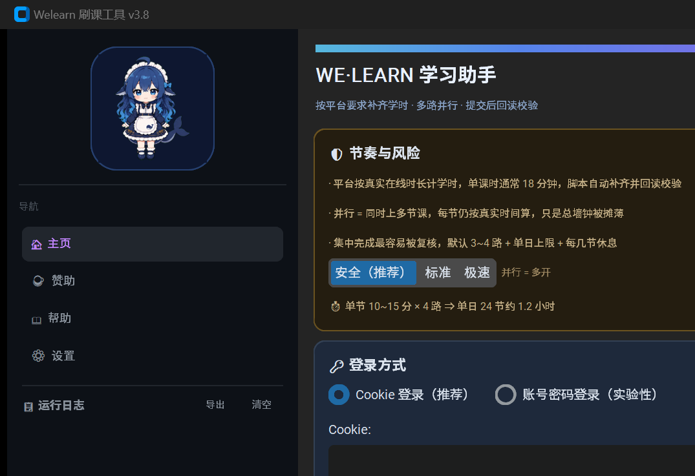

# WeLearn-GUI
[]()
[]()
[]()

> 一款面向高校 WE Learn 在线学习平台的可视化辅助学习工具，基于 CustomTkinter 图形界面实现课程学习自动化管理，全程本地运行，保障账号信息安全。
>


> **v4.0 运行态重做**：新增「只刷课」模式，进度区换成总览卡（总进度 + 每路单节进度 + 卡住提示 + 结果对账），跑起来就能看清每一路在干什么。
>
> **v3.8 界面重绘**：深海色调 + 渐变装饰条 + 立绘动效；并发 1~8 路可调（实测 4 路各自真实计时、零损耗），三档节奏预设。
>
> **v3.6 起按「真实学时」逻辑工作**：单课时按平台要求（`timelitsec`，通常 18 分钟）自动补齐、边学边心跳、提交后回读校验，单日上限 + 按节冷却。被清记录的原因与对策见 [docs/RISK_ANALYSIS.md](docs/RISK_ANALYSIS.md)。

## 项目介绍

本项目基于 Python 开发，使用 CustomTkinter 构建可视化操作界面，封装了 WE Learn 平台接口，支持刷课（自动完成课程小节 + 解析题目 + 答题记录）和刷时长（心跳保活）两种模式，极大简化重复的人工操作流程。

核心设计特点：
- 纯本地运行，无第三方中转服务器，数据不对外泄露
- 图形化交互界面，零基础用户可直接上手使用
- 多路并行：每路独立会话、各自真实计时，实测 4 路并行零损耗（墙钟 ÷4）
- 安全节奏：单日上限 + 按节冷却，兼顾速度与痕迹
- 学中持续心跳 + 提交后回读校验，时长是否真入账一目了然
- 学习进度实时与官网同步

## 核心功能

1. **账号登录模块**
   - 支持 Cookie 登录（推荐）和账号密码 SSO 登录
2. **课程信息加载**
   - 一键拉取个人所有已选线上课程
   - 区分已完成/未完成学习任务，直观展示进度
3. **刷课并计时** — 完成小节 + 生成答题记录 + 按平台要求补齐学时
4. **只刷课** — 只做题、只写答题记录，不补学时（先把完成度做上去）
5. **仅刷时长** — 心跳保活补学时，不动题目
6. **国际化** — 界面支持中文 / English 切换，深色/浅色主题
7. **运行态可视** — 每路一行：状态点、单节进度、已学/要求时长，卡住 45 秒自动提示
8. **节奏预设与并行** — 安全（推荐）/ 标准 / 极速三档，可调 1~8 路并行，启动前显示预计耗时并二次确认
9. **闸门检测** — 自动识别平台 `isPausing` 锁定与 `checkNoCaptcha` 滑块验证，命中即停下提示人工处理

## 环境依赖

- Python 3.8 及以上版本
- 兼容 Windows / macOS / Linux

### 依赖库

```txt
customtkinter>=5.2
requests>=2.26
Pillow>=9.0
```

## 使用方法

### 方式一：下载 exe（推荐）

从 [Releases](../../releases) 下载 `WelearnGUI.exe`，双击运行。

### 方式二：源码运行

```bash
pip install customtkinter requests Pillow
python src/welearn_gui.py
```

### 登录

1. 浏览器访问 [welearn.sflep.com](https://welearn.sflep.com/) 并登录
2. F12 → Network → 刷新页面 → 复制任意请求的 Cookie 值
3. 粘贴到软件 Cookie 输入框，点击登录

## 常见问题

**Q：为什么单课时要等十几分钟？**
平台按真实在线时长计学时：`startsco160928` 返回 `timelitsec`（实测 1080 秒），`useSeconds` 不够就不算学完。工具会按差额自动补齐，达标即停表。

**Q：刷完当天显示完成，第二天却没了？**
平台是「当天落完成事件、T+1 跨事件聚合复核」。短时间内集中完成、时长与要求差距过大、心跳断档都会命中复核。对策：用安全档、分几天跑、别一次刷完。详见 [docs/RISK_ANALYSIS.md](docs/RISK_ANALYSIS.md)。

**Q：能不能开多线程加速？**
不能。`studyTicket` 是单账号互斥锁，并发会让各课时互相 `EndSCO`，时长反而丢。v3.6 已强制单并发。

**Q：时长没达标怎么办？**
日志会显示「回读 XXXs / 平台要求 1080s」，再跑一次会自动补齐剩余部分。

## 打包

```bash
pip install pyinstaller
pyinstaller WelearnGUI.spec --clean
```

## 免责声明

本软件完全免费，仅供学习交流使用。

- 严禁任何形式的倒卖、商用行为
- 如您通过付费渠道获得本软件，请立即退款并举报
- 请合理使用本工具，由此产生的一切后果由使用者自行承担

## 致谢

- 界面立绘与动效取自开源桌宠素材 [@linxin666/dsh-pet](https://www.npmjs.com/package/@linxin666/dsh-pet)
  的 `whale-refined` 精灵图（BSD-3-Clause），仅取帧做界面装饰。

## 许可证

MIT License
